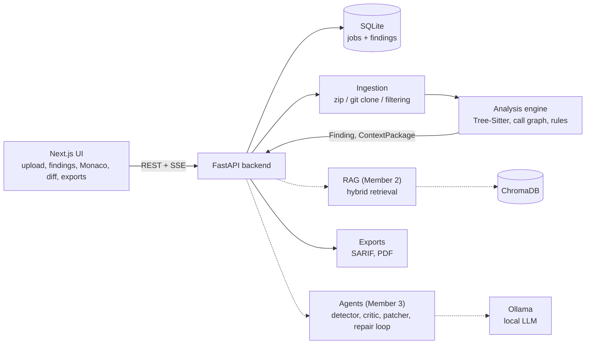

# AI-Powered Code Refactoring & Security Compliance Auditor

A hybrid pipeline for LLM-based vulnerability detection and patching: AST and call-graph context, project-specific RAG, and a verify-and-repair loop, with a web UI for upload, findings, patches and exports.

**Research question:** does combining AST and call-graph context with project-specific RAG and a verify-and-repair loop improve LLM-based vulnerability detection and patch quality over static analyzers and plain LLM prompting?

## Architecture



Solid lines are built and tested. Dashed lines are planned or in progress by other members.

## What works now

- **Upload and jobs:** zip upload (with zip-slip protection and a size limit) and git URL cloning, filtered to skip `node_modules`, `venv`, `build` and similar.
- **Background analysis** of Python files with the analysis engine, jobs and findings persisted in SQLite (they survive restarts).
- **Live progress** over Server-Sent Events.
- **Guideline upload** (PDF, Markdown, txt) saved to `backend/data/guidelines/` for the RAG pipeline.
- **UI:** upload page with progress bar, severity chart, severity and CWE filters, finding detail with Monaco viewer, and a diff viewer with accept, reject and download.
- **Exports:** SARIF 2.1.0 and a PDF report per job.
- **Analysis engine (Member 1):** Tree-Sitter parsing, structure extraction, call and dependency graphs, starter security rules (`eval`, `exec`, `shell=True`, hardcoded credentials).
- **Shared contracts** in `shared/schemas/`: `Finding`, `ContextPackage`, `RetrievalResponse`, `Patch`, `RunLog`.
- **CI** on GitHub Actions: ruff, pytest, TypeScript check, frontend build, Docker image build.

## Known limits

- Only **Python** files are scanned for findings. JavaScript and Java are parsed but not scanned yet.
- **Patches are mock data** (only `MOCK-1`). Real patch generation depends on the agent layer.
- RAG, Ollama and LangGraph agents, sandbox validation, self-repair, Semgrep/Bandit baselines and the evaluation suite are owned by Members 2 and 3 and are not wired into the backend yet.
- `docker-compose.yml` builds in CI but has **not been run end to end**. Please report results if you try it.

## API

| Method    | Route                         | Purpose                                                                     |
| --------- | ----------------------------- | --------------------------------------------------------------------------- |
| GET       | `/api/health`                 | Health check                                                                |
| POST      | `/api/analyze`                | Analyze a single Python snippet                                             |
| POST      | `/api/jobs`                   | Start a job from a git URL (`{"source_type":"git","source":"https://..."}`) |
| POST      | `/api/jobs/upload`            | Start a job from a zip (multipart field `file`)                             |
| GET       | `/api/jobs/{id}`              | Job status and progress                                                     |
| GET       | `/api/jobs/{id}/events`       | Live progress (SSE)                                                         |
| GET       | `/api/jobs/{id}/findings`     | Findings (`Finding` schema)                                                 |
| GET       | `/api/jobs/{id}/export/sarif` | SARIF export                                                                |
| GET       | `/api/jobs/{id}/export/pdf`   | PDF report                                                                  |
| GET       | `/api/findings/{id}/patch`    | Patch (mock for now)                                                        |
| POST, GET | `/api/guidelines`             | Upload or list guideline files                                              |

Interactive docs: `http://localhost:8000/docs`.

## Quick start

Open two terminals at the repository root.

**Backend**

```bash
pip install -r backend/requirements.txt
python -m uvicorn backend.app.main:app --reload --reload-dir backend --reload-dir shared --reload-dir analysis_engine
```

**Frontend** (Node.js 22 or newer)

```bash
cd frontend
npm install
npm run dev
```

Open `http://localhost:3000`. Use `localhost`, not `127.0.0.1`. If the backend is elsewhere, set `NEXT_PUBLIC_API_URL`.

**Tests**

```bash
python -m pytest -q
cd frontend && npx tsc --noEmit && npm run build
```

**Docker** (untested locally, see Known limits)

```bash
docker compose up --build
docker compose exec ollama ollama pull qwen2.5-coder:7b
```

## Repository structure

| Folder                                                             | Owner    | Contents                                        |
| ------------------------------------------------------------------ | -------- | ----------------------------------------------- |
| `analysis_engine/`                                                 | Member 1 | Parsing, ingestion, call graphs, security rules |
| `rag/`, `evaluation/`                                              | Member 2 | Retrieval, datasets, metrics                    |
| `agent/`                                                           | Member 3 | Models, agents, patches, validation             |
| `backend/`, `frontend/`, `.github/`, `docs/`, `docker-compose.yml` | Member 4 | API, UI, CI, deployment                         |
| `shared/schemas/`                                                  | Joint    | Cross-member contracts                          |
| `samples/`                                                         | Joint    | Small test inputs                               |

## Team workflow

- `main` is the stable branch. **Never push to it directly.**
- All work goes to `develop`. Always run `git pull origin develop` before starting and before pushing.
- Test your work and record a short demo video before every push.
- Resolve conflicts locally, re-test the combined result, then push.
- When `develop` is tested and integrated, the team lead merges `develop` into `main`.

## Shared contracts

Do not change `Finding`, `ContextPackage`, `RetrievalResponse`, `Patch` or `RunLog` without agreement from every affected member and a matching test update.

## Screenshots

Add screenshots of the upload page, findings view and diff viewer here before the release.
